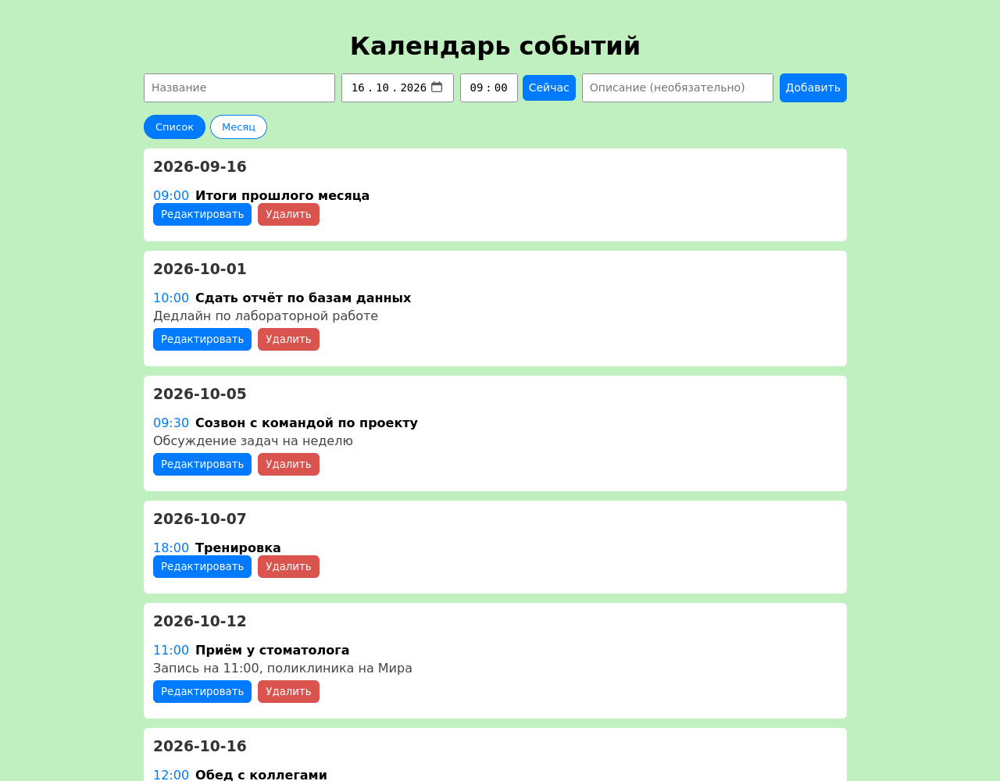
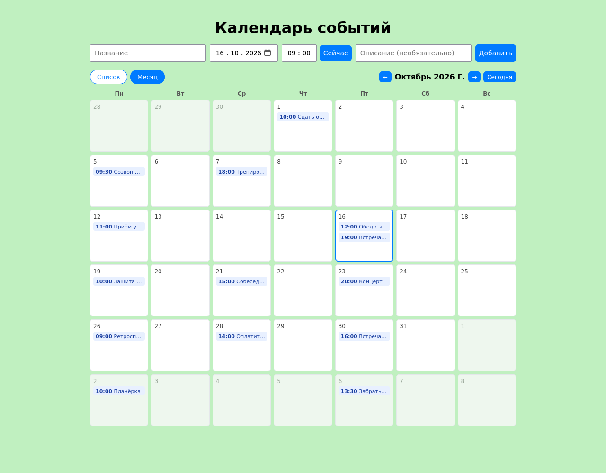
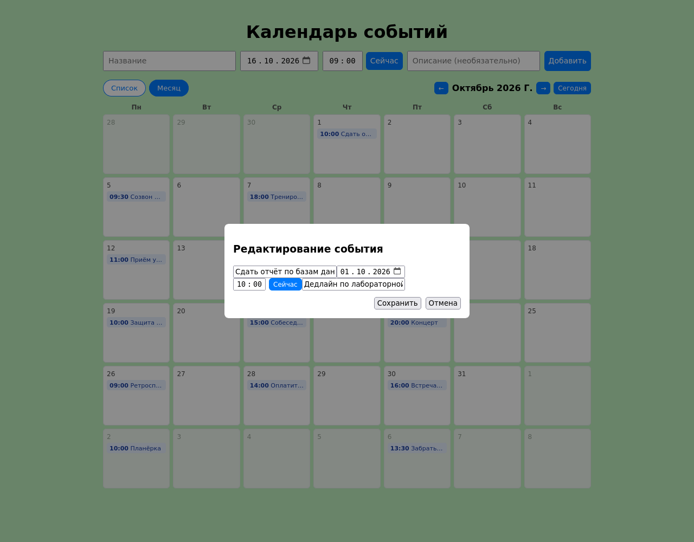
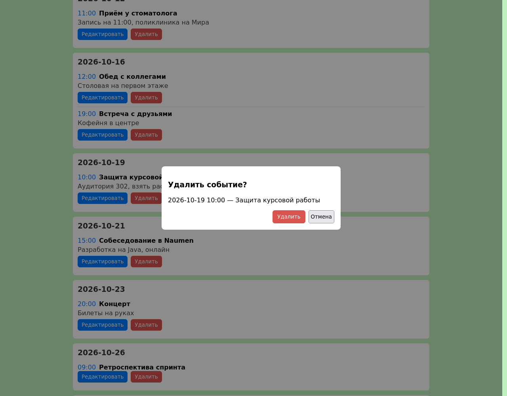
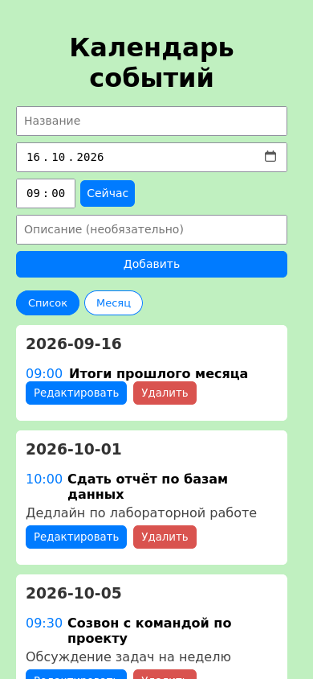
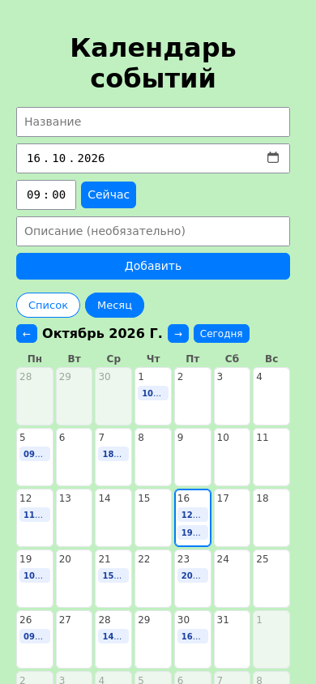

# Календарь событий

Веб-приложение для ведения списка событий: клиент на Vue 3 отправляет запросы к REST API
на Express, события хранятся в SQLite. События можно добавлять, редактировать и удалять
без перезагрузки страницы, а смотреть - списком по дням или сеткой на месяц.

Режим списка: события сгруппированы по датам, у каждого есть кнопки правки и удаления.



Режим сетки: месяц целиком, события показаны плашками внутри дня.



Модальные окна редактирования и удаления:

| Редактирование | Удаление |
| --- | --- |
|  |  |

На узком экране форма выстраивается в столбик, сетка уплотняется:

| Список | Сетка |
| --- | --- |
|  |  |

## Стек

| Слой | Технологии |
| --- | --- |
| Сервер | Node.js, Express 5, sqlite3, cors |
| Клиент | Vue 3 (Composition API), Vite 7, axios |
| Хранилище | SQLite, файл `backend/events.db` |
| Тесты | встроенный модуль `node:test`, без сторонних библиотек |

## Режимы отображения

| Режим | Что показывает |
| --- | --- |
| Список | события, сгруппированные по датам, по возрастанию времени |
| Сетка | месяц целиком, неделя начинается с понедельника, сегодняшний день выделен, дни соседних месяцев приглушены |

В режиме сетки есть переход по месяцам и кнопка возврата к текущему месяцу. Клик по дню
подставляет дату в форму добавления, клик по плашке события открывает его на
редактирование, длинные названия обрезаются многоточием и видны в подсказке.

## Структура

```
calendar-app/
├── backend/
│   ├── server.js            # REST API: GET, POST, PUT, DELETE /events
│   ├── events.db            # база с двумя примерами событий
│   ├── test/events.test.js  # проверки API на отдельной базе
│   └── package.json
├── frontend/
│   ├── src/
│   │   ├── App.vue          # форма, список по дням, модальные окна
│   │   ├── styles.css
│   │   └── main.js
│   ├── index.html
│   └── vite.config.js
├── docs/
│   ├── Техническое-задание.md
│   ├── screenshot.png            # список, сетка, модальные окна, узкий экран
│   ├── screenshot-grid.png
│   ├── screenshot-edit.png
│   ├── screenshot-delete.png
│   ├── screenshot-mobile.png
│   └── screenshot-mobile-grid.png
└── README.md
```

## Быстрый старт

Нужен Node.js 20.19 или новее.

```bash
cd backend
npm install
npm start                  # API на http://localhost:3000
```

Клиент в режиме разработки запускается отдельно:

```bash
cd frontend
npm install
npm run dev                # страница на http://localhost:5173
```

Запросы к API из режима разработки идут через прокси Vite, поэтому CORS не участвует.
Отдельный адрес API задаётся переменной `VITE_API_URL`.

Для сборки под продакшен:

```bash
cd frontend
npm run build              # результат в frontend/dist
```

Собранный клиент раздаёт сам сервер: после `npm run build` достаточно открыть
`http://localhost:3000`, отдельный веб-сервер не нужен. В этом режиме запросы идут
на тот же адрес, с которого открыта страница.

База `backend/events.db` уже лежит в репозитории с набором примеров событий, поэтому
приложение запускается сразу. Если файла нет, он создаётся при первом старте вместе с
таблицей `events` и индексом по дате и времени.

## API

| Метод | Адрес | Назначение |
| --- | --- | --- |
| GET | `/events` | список всех событий по возрастанию даты и времени |
| POST | `/events` | создание события, ответ 201 с записью и новым `id` |
| PUT | `/events/:id` | полное обновление события |
| DELETE | `/events/:id` | удаление события |

Тело запроса для POST и PUT:

```json
{
  "title": "Собеседование",
  "date": "2026-11-03",
  "time": "14:30",
  "description": "Онлайн"
}
```

| Код | Когда возвращается | Тело ответа |
| --- | --- | --- |
| 400 | пустое название, несуществующая дата или время, дата вне диапазона 2000-2100, нечисловой `id`, битый JSON | `{"error": "INVALID_PAYLOAD"}` |
| 201 | событие создано | запись с новым `id` |
| 404 | события с таким `id` нет, либо запрошен неизвестный маршрут | `{"error": "NOT_FOUND"}` |
| 500 | ошибка базы данных | `{"error": "DB_ERROR"}` |

## Переменные окружения

| Переменная | Обязательна | По умолчанию | Назначение |
| --- | --- | --- | --- |
| `PORT` | нет | 3000 | порт API |
| `DB_PATH` | нет | `backend/events.db` рядом с сервером | путь к файлу базы |
| `VITE_API_URL` | нет | адрес открытой страницы | адрес API для клиента сборки |

## Тесты

```bash
cd backend
npm test
```

Шестнадцать проверок на отдельной базе во временном каталоге: пустой календарь,
создание события, порядок сортировки, отклонение пустого названия, несуществующих
дат (31 февраля, 99-й месяц) и времени (24:00, 99:99), границ диапазона дат,
сохранение числового описания строкой, ответ 400 на битый JSON, полное обновление
события, коды 404 и 400 для несуществующих и некорректных идентификаторов, удаление,
ответ 404 на неизвестный маршрут, заголовки CORS только для клиента разработки.
Файл `backend/events.db` не изменяется.

Дополнительно вёрстка проверена в браузере на ширине 1280 и 390 пикселей: страница и
блоки не выходят за границы экрана, содержимое обрезается там, где это задумано.

## Ограничения

Валидация проверяет существование даты и попадание в диапазон 2000-2100, но не
запрещает события в прошлом. В режиме сетки на узком экране в плашке помещается
только время, полные названия видны в режиме списка. CORS разрешён только для клиента
разработки на порту 5173. Пагинации нет: клиент загружает все события одним запросом.

## Лицензия

MIT, см. `LICENSE`.
